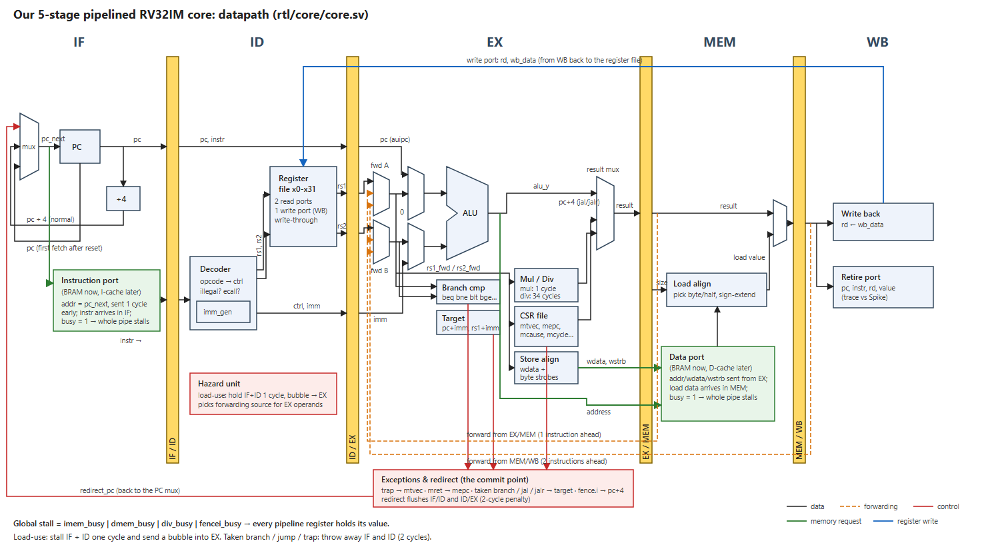

**What exists, in one sentence:** a 5-stage pipelined RISC-V CPU (RV32IM) written in SystemVerilog, plus one automatic test setup that runs the 49 official RISC-V test programs on it (each twice). Everything currently passes.

---

## 1. Where did the CPU code come from?

**It was written from scratch for this project. It was not copied from any repository**
The classic 5-stage RISC pipeline | **Yes, this is the design we follow**: Patterson & Hennessy, *Computer Organization and Design, RISC-V Edition* (ch. 4), and Harris & Harris, *Digital Design and Computer Architecture, RISC-V Edition* (ch. 7) |

The diagram you shared (Control_Unit, ALU_Control, Forwarding Unit, IF/ID…MEM/WB registers) is that same textbook-style pipeline. **Our core is the same idea with extra features**


## 2. The datapath (the most important picture)



(Sharper, zoomable version: open [`docs/datapath.svg`](docs/datapath.svg) in a browser.)

**Colours:** black = data, orange dashed = forwarding, red = control (redirect), green = memory requests, blue = register write-back.


---

## 3. How the pipeline handles problems ("hazards")

### 3.1 Forwarding: using a result before it is written back
```
add x1, x2, x3     IF ID EX ME WB
sub x4, x1, x5        IF ID EX ME WB     ← needs x1 in EX; add is only in MEM
```
The result of `add` is sitting in the EX/MEM register, so fwd A takes it from there (orange line). Priority: EX/MEM (newest) → MEM/WB → register file.

### 3.2 Load-use: we must wait 1 cycle
```
lw  x1, 0(x2)      IF ID EX ME WB
add x3, x1, x1        IF ID ID EX ME WB  ← ID repeated (stall), empty "bubble" goes into EX
```
Load data only exists at the end of MEM. After one stall cycle, the load is in WB and forwarding from MEM/WB works.

### 3.3 Taken branch: throw away 2 instructions
```
beq x1, x2, L      IF ID EX              ← decided here
(next)                IF ID ✗            ← thrown away
(next+1)                 IF ✗            ← thrown away
L: ...                      IF ID EX
```

### 3.4 Slow memory / divide: freeze everything
`global_stall = imem_busy | dmem_busy | div_busy | fencei_busy`. While it is 1, every yellow register keeps its value, so the whole pipeline pauses.

### 3.5 Traps (errors)
If an instruction in EX is illegal, misaligned, `ecall` or `ebreak`:
- the CPU saves its address in `mepc`, the reason in `mcause` (2 = illegal, 11 = ecall, …) and extra information in `mtval`,
- then it jumps to the handler address in `mtvec`.

The faulty instruction writes nothing. `mret` returns to `mepc`.

---

## 4. How the CPU talks to memory (different from the README plan!)

⚠️ `README.md` §8.6 describes a simpler `req`/`ready` interface. While building the core it turned out that FPGA Block RAM needs the address **one clock before** the data comes out. So the real interface is:

```
core → memory :  req, addr, (we, wdata, wstrb for data), hold
memory → core :  rdata, busy
```
1. Cycle N: the core puts a request out. If `hold = 0`, memory **accepts** it at the end of cycle N.
2. Cycle N+1: memory gives `rdata`. If it needs longer (cache miss), it sets `busy = 1`, and the pipeline freezes until `busy = 0`.
3. `hold = 1` means "the pipeline is frozen: don't take a new request, keep `rdata` the same".

That is why the fetch address is **pc_next** (sent one cycle early) and the data address leaves from **EX** (data returns in MEM). **Your caches (Phase 4) must follow this contract.**

---

## 5. Why SystemVerilog and not plain Verilog?

SystemVerilog is Verilog with extras (every Verilog file is valid SystemVerilog). We use:
- `logic`: one signal type, no `wire`/`reg` confusion.
- `always_ff` / `always_comb`: the tools check you meant a flip-flop or plain logic.
- `enum`: named states and operations (e.g. `ALU_ADD`), which also show by name in waveforms.
- `struct packed`: each pipeline register is one named bundle (`id_ex.ctrl.is_load`).
- `package`: shared constants and types in one file.

Vivado, Verilator and cocotb all support it, and HOLY CORE uses it too.

---

## 6. Every file, what type it is, and what it does

### 6.1 File types used

| Extension | Type | Who reads it |
|---|---|---|
| `.sv` | **SystemVerilog**: hardware description (the CPU itself, or simulation-only test hardware) | Verilator (simulator), later Vivado |
| `.py` | **Python**: test scripts (cocotb + pytest) and small tools | Python 3 |
| `.S` | **RISC-V assembly** test programs (capital S = the C preprocessor runs first, so `#include`/`#define` work) | riscv64-unknown-elf-gcc |
| `.h` | Header with **macros** for the assembly tests | the assembler |
| `.ld` | **Linker script**: says at which address code and data go | the linker |
| `Makefile` | Recipes for `make` (compile / run / clean) | make |
| `.ini` | pytest settings | pytest |
| `.gitignore` | Which files git should ignore (generated stuff) | git |
| `.md` | Documentation (Markdown) | you |
| `.svg` / `.png` | The datapath drawing (vector / picture) | browser, VS Code |
| *generated* `.elf` `.bin` `.hex` `.dump` `.xml` `.vcd` | compiled program / raw bytes / memory image / disassembly / test results / waveform | see §6.4 |

### 6.2 The CPU (hardware, `rtl/`)

| File | What it does |
|---|---|
| `rtl/pkg/core_pkg.sv` | **Shared definitions**: RISC-V opcodes, trap codes, the list of ALU operations, the control bundle `ctrl_t`, and the 4 pipeline-register bundles (`if_id_t`, `id_ex_t`, `ex_mem_t`, `mem_wb_t`) |
| `rtl/core/core.sv` | **The pipeline itself (top level)**: connects every block below, holds PC + the 4 pipeline registers, stall/flush logic, forwarding muxes, trap decisions, the memory ports |
| `rtl/core/decoder.sv` | Instruction bits → control signals. Marks unknown instructions as illegal |
| `rtl/core/imm_gen.sv` | Rebuilds the 32-bit constant (I, S, B, U, J, CSR-immediate formats) |
| `rtl/core/regfile.sv` | Registers x0–x31 (x0 is always 0). 2 reads + 1 write per cycle. A value written this cycle can be read this cycle |
| `rtl/core/hazard_unit.sv` | Picks forwarding sources, and detects load-use (stall 1 cycle) |
| `rtl/core/alu.sv` | add, sub, shifts, and/or/xor, set-less-than |
| `rtl/core/branch_unit.sv` | Compares rs1/rs2 for beq, bne, blt, bge, bltu, bgeu |
| `rtl/core/muldiv.sv` | Multiply (1 cycle) and divide/remainder (34 cycles, one bit per cycle) |
| `rtl/core/csr_file.sv` | Control & status registers (mstatus, mtvec, mepc, mcause, mtval, mcycle, minstret, …), trap entry and `mret` |
| `rtl/core/store_align.sv` | For stores: copies the byte/half into the right position and sets the byte-enable bits (`wstrb`). Checks alignment |
| `rtl/core/load_align.sv` | For loads: picks the right byte/half out of the 32-bit word and extends the sign. Checks alignment |

### 6.3 The tests

| File | What it does |
|---|---|
| `tb/common/sim_mem.sv` | **Fake memory for simulation only.** It speaks the §4 protocol and loads a program from a `.hex` file. It can **randomly delay answers** (`+stall_pct=30`) to act like cache misses. Special address `0xF000_0000` = "TOHOST": the test program writes its result there |
| `tb/common/tb_core.sv` | **Test top**: CPU + fake memory wired together. Counts finished instructions and prints a trace line per instruction when `+trace` is given |
| `tb/isa/test_isa.py` | Runs the test programs: builds the design with Verilator once, then for each program starts a simulation, waits until it writes TOHOST, and reports PASS / FAIL (with the failing sub-test number or the trap cause) |
| `sw/isa_tests/Makefile` | Compiles the test programs: `.S` → `.elf` → `.bin` → `.hex` (+ a `.dump` disassembly for reading) |
| `sw/isa_tests/env/riscv_test.h` | Our small "test environment": macros the official tests expect (start address, how to report PASS/FAIL, a handler for unexpected traps) |
| `sw/isa_tests/env/link.ld` | Linker script for tests: everything starts at address 0 (where our CPU begins after reset) |
| `third_party/riscv-tests/` *(downloaded by `make deps`, not in the folder until then)* | The **official RISC-V test programs** (not written by us): one program per instruction, each with many sub-tests |

### 6.4 Tools, build and docs

| File | What it does |
|---|---|
| `Makefile` (top) | Shortcuts: `make deps`, `make lint`, `make test`, `make clean` |
| `pytest.ini` | Tells pytest where the tests are and to not create a cache folder |
| `.gitignore` | Keeps `build/` and `third_party/` out of git |
| `tools/bin2hex.py` | Turns a raw binary into a text file with one 32-bit word per line (the format Verilog's `$readmemh` loads) |
| `docs/datapath.svg`, `docs/datapath.png` | The datapath drawing |
| `README.md` | The overall plan (all phases) |
| `first.md` | This file |
| `build/` *(created when you run tests; safe to delete)* | `build/isa/*.elf` compiled programs, `*.bin` raw bytes, `*.hex` memory images, `*.dump` disassembly · `build/sim_isa/` Verilator's compiled simulator (+ `dump.vcd` waves) · `build/results/*.xml` pass/fail records |

### 6.5 How one test runs, end to end
```
add.S ──gcc──► add.elf ──objcopy──► add.bin ──bin2hex.py──► add.hex
                                                               │ loaded by sim_mem.sv ($readmemh)
                                                               ▼
   pytest ─► cocotb ─► Verilator simulation of tb_core (CPU + fake memory)
                             │ CPU runs the program…
                             │ program stores 1 (pass) or (n<<1)|1 (fail) to 0xF000_0000
                             ▼
   cocotb sees tohost_valid, reads the value ─► PASS / "FAILED in sub-test #n"
```

---

## 7. How to run everything (commands)

All simulation tools live in **WSL (Ubuntu)**, which is already installed on your laptop with everything needed (Verilator 5.038, Icarus, cocotb 2.0.1, pytest, `riscv64-unknown-elf-gcc` 13.2, GTKWave).

**Step 1: open a WSL terminal in the project** (from Windows PowerShell or the VS Code terminal):
```bash
wsl
cd /mnt/c/Users/sowmi/OneDrive/Desktop/doom
```

**Step 2: run things:**

| Command | What it does / tests | Takes | Expected result |
|---|---|---|---|
| `make deps` | Downloads the official riscv-tests into `third_party/` (once; `make test` also does it automatically) | ~10 s | a folder `third_party/riscv-tests` |
| `make lint` | Verilator reads all CPU files and complains about any mistake (wrong widths, loops, typos). Doesn't simulate anything | 2 s | no `%Warning`/`%Error` lines |
| `make test` | Compiles the 49 test programs, then runs each on the whole CPU **twice**: with instant memory and with 30% randomly slow memory | ~1 min | `98 passed` |
| `make clean` | Deletes `build/` | instant | |

**Run a single test program:**
```bash
python3 -m pytest -v -k "rv32ui-add-ideal" tb/isa/test_isa.py        # just the "add" test, instant memory
python3 -m pytest -v -k "rv32um" tb/isa/test_isa.py                  # all multiply/divide programs
```
Names look like `rv32ui-<instruction>-ideal-mem` or `…-random-stalls`. `rv32ui` = base integer instructions, `rv32um` = multiply/divide.

**See every instruction the CPU executes** (the trace):
```bash
TRACE=1 python3 -m pytest -s -k "rv32ui-add-ideal" tb/isa/test_isa.py | grep TRACE | head -20
```
Each line: `TRACE <address> <instruction bits> x<reg>=<value written>`. Compare it with the disassembly `build/isa/rv32ui-add.dump` to see which instruction each line is.

**Look at waveforms** (every signal over time):
```bash
WAVES=1 python3 -m pytest -k "rv32ui-add-ideal" tb/isa/test_isa.py
gtkwave build/sim_isa/dump.vcd &
```
In GTKWave, open `tb_core → u_core` on the left and drag signals like `pc`, `if_id`, `id_ex`, `global_stall`, `load_use_stall`, `redirect` into the view.

---

## 8. What the tests prove (and what they don't)

| Proven in simulation | How |
|---|---|
| Every RV32I and M instruction gives correct results | 49 official riscv-tests programs pass |
| Forwarding, load-use stalls and branch flushes are correct | Those programs are full of back-to-back dependent instructions and branches |
| The pipeline survives slow memory | Every program also passes with 30% of memory requests randomly delayed 1–8 cycles |
| The tests really detect failures | Two deliberately wrong programs were correctly reported as FAIL ("sub-test #3", "mcause = 11") |

(Earlier there were also ALU and mul/div unit tests and a CSR/trap test program. They were removed to keep the folder small, so CSRs and traps are **no longer covered** by any test.)

| **Not** proven yet | Why it matters |
|---|---|
| CSRs, counters, traps, `mret` | No test covers them anymore (the official set used here has none) |
| Runs on the real FPGA | Not built with Vivado yet: clock speed and size unknown (Phase 3) |
| Instruction-by-instruction match with Spike (the official RISC-V simulator) | Spike isn't installed yet |
| RISCOF (official compliance suite) | Not set up yet |
| A C program | Needs startup code (`crt0.S`) and a linker script for C: the first part of `sw/lib` |

**A bug found while testing:** the `minstret` counter ("instructions finished") was counted when instructions left WB. A program reading it got a number up to 2 too low, because older instructions were still in MEM/WB. The fix: count when an instruction passes EX without error (from then on it always finishes). (The test that caught it was removed in the cleanup.)

---

## 9. Where the built design differs from `README.md`

| README says | What was built | Why |
|---|---|---|
| Phase 1: single-cycle CPU first | Skipped: went straight to the 5-stage pipeline (your choice) | You can still do Phase 1 as practice |
| §8.6 memory interface `req`/`ready` | `req`/`hold` → `rdata`/`busy`, answer 1 cycle later (§4 above) | FPGA Block RAM timing |
| §8.4 multiply over 2 cycles | Multiply in 1 cycle (may be split later if it limits the FPGA clock) | Simpler first; measure in Vivado |
| Toolchain `riscv-none-elf-gcc` (xPack) | `riscv64-unknown-elf-gcc` from Ubuntu (already in your WSL) | Same compiler; builds 32-bit code with `-march=rv32im… -mabi=ilp32` |
| §17 folder layout | Added `tb/common/`, `tb/isa/`, `sw/isa_tests/`, `tools/bin2hex.py`, `first.md` (+ `third_party/`, `build/` when tests run) | Needed for the tests |

---

## 10. Status against the plan

| Phase | Status |
|---|---|
| 0: Setup | 🟡 WSL tools ready; Vivado, board test and `git init` still to do |
| 1: Single-cycle CPU | ⏭️ skipped |
| 2: Pipeline + M + CSRs | 🟡 core done and passing; Spike trace, RISCOF and a first C program left |
| 3 onwards | ⬜ not started |

---

## 11. Your turn: how to learn this core (do these yourself)

**Reading order** (each file is short and commented):
1. `rtl/pkg/core_pkg.sv`: the vocabulary.
2. `alu.sv`, `branch_unit.sv`, `imm_gen.sv`, `regfile.sv`: small, self-contained blocks.
3. `decoder.sv`: open the RISC-V spec's instruction table next to it.
4. `hazard_unit.sv`, then `core.sv`, stage by stage, with the datapath picture open.
5. `muldiv.sv`, `csr_file.sv`.
6. `tb/common/sim_mem.sv` and `tb/isa/test_isa.py`: how testing works.

**Exercises** (each teaches something; undo your change afterwards):
1. **Trace by hand:** run the `TRACE=1` command for `rv32ui-add`. Pick 5 lines and find the matching instructions in `build/isa/rv32ui-add.dump`.
2. **Break forwarding:** in `core.sv`, make `rs1_fwd` always use `id_ex.rs1_val` (ignore `fwd_a`). Run `make test`. Which tests fail, and why?
3. **Break the load-use stall:** in `hazard_unit.sv`, set `load_use_stall = 1'b0`. Which tests fail?
4. **Watch a stall:** open waveforms for `rv32ui-lw` and find a cycle where `load_use_stall` is 1. What are `if_id`, `id_ex` doing?
5. **Write your own test:** copy an official test (e.g. `third_party/riscv-tests/isa/rv64ui/add.S`) into a new folder `sw/isa_tests/custom/`, change the `TEST_CASE`s, and add a build rule for it in `sw/isa_tests/Makefile` (copy the `rv32ui-%` rule).
6. **Measure the branch penalty:** write a loop of 100 iterations and compare the cycle count printed by the test with the number of instructions retired.

**Next build step (you write it, Claude guides):** either finish Phase 2 (Spike, RISCOF, first C program), or start **Phase 4: caches**. The caches must follow the memory contract in §4.
